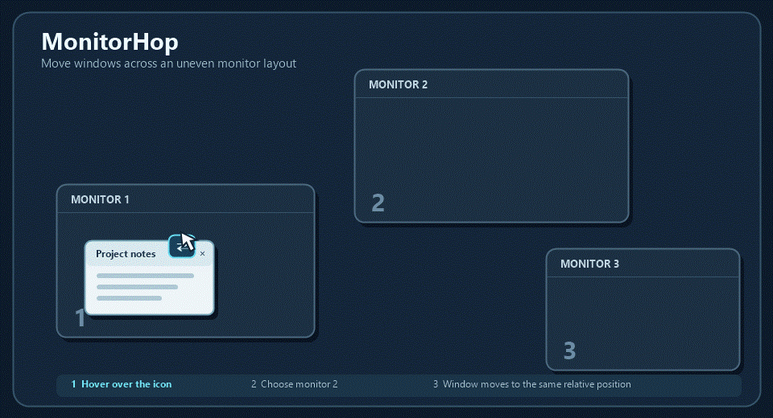
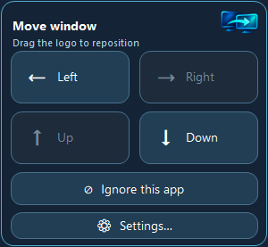
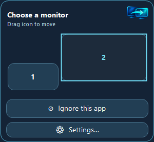
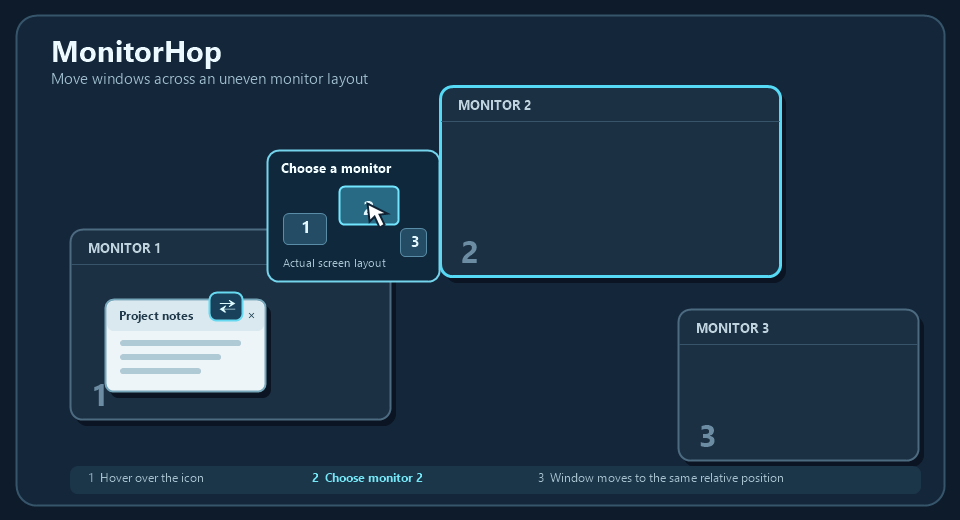

# MonitorHop

A small Windows 10/11 utility for moving the active window between monitors. [Download the installer](https://github.com/danilyu4ka/MonitorHop/releases/latest/download/MonitorHop-Setup.exe) or follow the [illustrated installation guide](docs/INSTALL_GUIDE_EN.md).



*Illustrated example: monitor 2 sits above and to the right of monitor 1; monitor 3 sits farther right and lower.*

Created by [danilyu4ka](https://github.com/danilyu4ka). Licensed under [MIT](LICENSE). See the [corporate deployment notes](docs/CORPORATE_DEPLOYMENT_EN.md) for the install footprint and security details, and [code-signing options](docs/CODE_SIGNING_EN.md) for SmartScreen behavior.

The `codex/microsoft-store` branch contains a separate [Microsoft Store MSIX build and submission guide](docs/MICROSOFT_STORE_EN.md). It requires the product identity values from your Partner Center account before its package can be submitted.

## How it works

When at least two monitors are active, a small translucent button appears beside the upper-right controls of the active window. Hover over it to open the move menu. Choose a direction or switch to a map that shows the actual monitor arrangement. MonitorHop places the window at approximately the same relative position on the destination monitor. Maximized windows remain maximized.

| Direction buttons | Monitor map |
| :---: | :---: |
|  |  |

For an uneven arrangement, enable **Show monitor map instead of arrows** in Settings. The map follows the monitors' positions in Windows Display settings, so you can choose a screen above, below, or diagonally across from the current one.



With one monitor, MonitorHop stays in the tray and hides the overlay until another display is connected. If the button covers a window control, drag it to a nearby position. You can also drag the open menu by its upper-right logo. The offset is saved and applied to other windows.

## Install and run

- [MonitorHop-Setup.exe](https://github.com/danilyu4ka/MonitorHop/releases/latest/download/MonitorHop-Setup.exe) is a classic Inno Setup wizard. It offers English, Russian, and Estonian. The system language is selected when supported; otherwise English is selected. It creates desktop and Start menu shortcuts and a standard entry in **Windows Settings → Apps → Installed apps**.
- [MonitorHop.exe](https://github.com/danilyu4ka/MonitorHop/releases/latest/download/MonitorHop.exe) is a portable, self-contained single executable.

The installer works for the current user without administrator rights and installs under `%LOCALAPPDATA%\Programs\MonitorHop`. Use the shortcuts to start or restart the app. Double-click the tray icon for Settings; right-click it to disable the overlay or exit. Windows uninstall removes the app, shortcuts, startup entry, and uninstall entry. Settings remain for a future reinstall.

## Controls and settings

The default shortcut is **Ctrl+Shift+Alt + arrow key**. Settings lets you change the modifiers, select the interface language, start with Windows, ignore full-screen apps, show the monitor map instead of arrows, and adjust the collapsed button's opacity (30–100%) and size (60–160%). Full-screen apps are ignored by default.

Once per launch, MonitorHop checks the latest published [GitHub release](https://github.com/danilyu4ka/MonitorHop/releases), unless you turn off **Check for updates at startup** in Settings. If its version is newer, a prompt offers to open that release page in your browser. You decide whether to download and run the installer; the app does not download or execute updates itself. The installer closes a running MonitorHop before replacing files. A failed or offline check is silent.

Use **Ignore this app** in the overlay to ignore the current application. Settings lists applications with visible windows on the connected displays; tick the ones to ignore. **Advanced** accepts process names manually, including apps that are not currently open. An ignored process name applies to all its instances.

Settings are stored in `%LOCALAPPDATA%\MonitorHop\settings.json`; unexpected errors are written to `error.log` in the same folder. Version 1.4.2 and later move an existing settings file from the previous folder on first launch. Some elevated apps or apps that manage their own windows may resist movement. Moving a snapped window can remove its Snap placement.

## Build from source

Install the .NET 10 SDK and Inno Setup 6, then run:

```powershell
$version = (dotnet msbuild MonitorHop/MonitorHop.csproj -getProperty:Version).Trim()
dotnet publish MonitorHop/MonitorHop.csproj -c Release -r win-x64 --self-contained true -p:Version=$version -p:PublishSingleFile=false -p:PublishTrimmed=false -p:DebugType=None -p:DebugSymbols=false -o install-payload
& "${env:ProgramFiles(x86)}\Inno Setup 6\ISCC.exe" "/DAppVer=$version" installer/MonitorHop.iss
dotnet publish MonitorHop/MonitorHop.csproj -c Release -r win-x64 --self-contained true -p:Version=$version -p:PublishSingleFile=true -p:IncludeNativeLibrariesForSelfExtract=true -p:PublishTrimmed=false -p:DebugType=None -p:DebugSymbols=false -o release
```

The installed build keeps the .NET files under the app directory, while the portable build is one executable. A tagged GitHub Actions build takes its version from the tag and passes the same value to both the app and installer.
