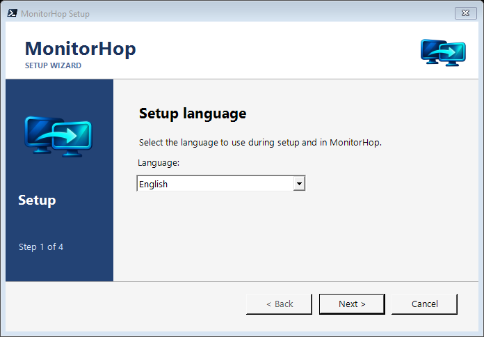
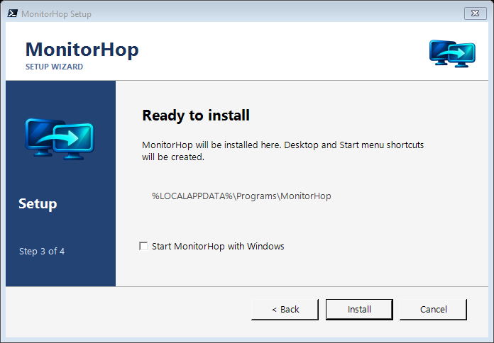
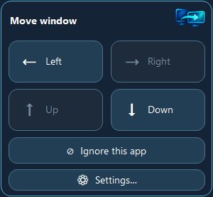
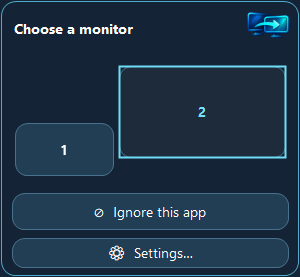
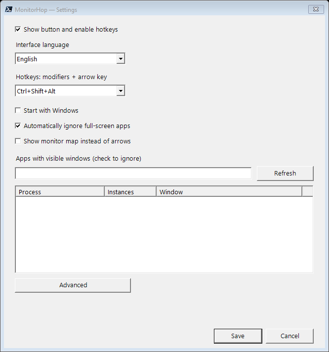

# MonitorHop: illustrated installation guide

MonitorHop is a Windows 10/11 utility for moving the active window between monitors. It places a small translucent button beside the active window's title bar controls. Hover over the button to open the move menu.

## 1. Download and open the installer

Download [**MonitorHop-Setup.exe**](https://github.com/danilyu4ka/MonitorHop/releases/latest/download/MonitorHop-Setup.exe) and double-click it. The installer is a single executable and installs for your Windows account without administrator rights.



The first page selects both the setup language and the app language. If your Windows language is Russian or Estonian, that language is preselected. English is used for other system languages. Choose a language and click **Next**.

## 2. Continue through the wizard


On the welcome page, click **Next**. On the next page, review the install location and optionally select **Start MonitorHop with Windows**. The program installs under `%LOCALAPPDATA%\Programs\MonitorHop` and creates desktop and Start menu shortcuts.



Click **Install**. When setup completes, leave **Launch MonitorHop now** selected and click **Finish**.


MonitorHop runs in the Windows notification area. Double-click its tray icon to open Settings; right-click it to disable the overlay or exit the app. If only one monitor is active, MonitorHop keeps running in the tray and hides its overlay until a second monitor is connected.

## 3. Move a window

Activate a normal window and hover over the translucent MonitorHop button near its upper-right corner. Choose a direction to move the window to the neighboring monitor. The new window position is approximately the same relative position on the destination screen. The default keyboard shortcut is **Ctrl+Shift+Alt + arrow key**.



For a nonstandard monitor layout, open Settings and select **Show monitor map instead of arrows**. Hover over the button again and click the target monitor rectangle.



## 4. Adjust settings and ignored apps

Settings lets you change the language, hotkey modifiers, Windows startup, full-screen app handling, and the monitor map. Full-screen apps are ignored by default.



To ignore an application, use **Ignore this app** in the overlay menu, or tick it in the Settings list. This list shows only apps with visible windows on your screens. The **Advanced** section accepts process names manually, including apps that are not currently running.

## 5. Uninstall

Open **Windows Settings → Apps → Installed apps**, find **MonitorHop**, and select **Uninstall**. This removes the installed executable, shortcuts, and Windows startup entry. Your settings file remains at `%LOCALAPPDATA%\Менялка экрана\settings.json` so preferences can be restored after reinstalling.

## Build from source

The project targets Windows x64 and .NET 10. To create the standalone executable and setup launcher:

```powershell
dotnet publish MonitorHop/MonitorHop.csproj -c Release -r win-x64 --self-contained true -p:PublishSingleFile=true -p:IncludeNativeLibrariesForSelfExtract=true -p:PublishTrimmed=false -p:DebugType=None -p:DebugSymbols=false -o release
Copy-Item release/MonitorHop.exe release/MonitorHop-Setup.exe
```

The `-Setup.exe` filename opens the wizard. `MonitorHop.exe` can also run as a portable app, or open the same wizard with `--install`.
