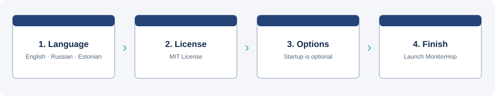

# MonitorHop: illustrated installation guide

MonitorHop is a Windows 10/11 utility for moving the active window between monitors. It places a small translucent button beside the active window's title bar controls. Hover over the button to open the move menu.

## 1. Download and open the installer

Download [**MonitorHop-Setup.exe**](https://github.com/danilyu4ka/MonitorHop/releases/latest/download/MonitorHop-Setup.exe) and double-click it. The installer is a single executable and installs for your Windows account without administrator rights.



The **Select Setup Language** dialog appears before the wizard. Choose English, Russian, or Estonian and click **OK**. If your Windows language is Russian or Estonian, it is preselected; English is used for other system languages. On a fresh installation, this choice also sets the app language.

## 2. Continue through the wizard

Read and accept the MIT License, then continue through the classic wizard. On **Additional Tasks**, optionally select **Start MonitorHop with Windows**. This option is off by default. The program installs under `%LOCALAPPDATA%\Programs\MonitorHop` and creates desktop and Start menu shortcuts.

Click **Install**. When setup completes, leave **Launch MonitorHop** selected and click **Finish**. To update an existing installation, exit MonitorHop from its tray menu before running setup. Your existing preferences are preserved.

MonitorHop runs in the Windows notification area. Double-click its tray icon to open Settings; right-click it to disable the overlay or exit the app. If only one monitor is active, MonitorHop keeps running in the tray and hides its overlay until a second monitor is connected.

## 3. Move a window

Activate a normal window and hover over the translucent MonitorHop button near its upper-right corner. Choose a direction to move the window to the neighboring monitor. The new window position is approximately the same relative position on the destination screen. The default keyboard shortcut is **Ctrl+Shift+Alt + arrow key**.

If the button covers something you need, drag the small button to a nearby position. Once the menu is open, you can also drag its logo in the upper-right corner. MonitorHop remembers this offset for other windows.


For a nonstandard monitor layout, open Settings and select **Show monitor map instead of arrows**. Hover over the button again and click the target monitor rectangle.


## 4. Adjust settings and ignored apps

Settings lets you change the language, hotkey modifiers, Windows startup, full-screen app handling, and the monitor map. Full-screen apps are ignored by default.


To ignore an application, use **Ignore this app** in the overlay menu, or tick it in the Settings list. This list shows only apps with visible windows on your screens. The **Advanced** section accepts process names manually, including apps that are not currently running.

## 5. Uninstall

Open **Windows Settings → Apps → Installed apps**, find **MonitorHop**, and select **Uninstall**. This removes the installed executable, shortcuts, and Windows startup entry. Your settings file remains at `%LOCALAPPDATA%\Менялка экрана\settings.json` so preferences can be restored after reinstalling.

## Build from source

The project targets Windows x64 and .NET 10. To create the installer, install Inno Setup 6 and run:

```powershell
dotnet publish MonitorHop/MonitorHop.csproj -c Release -r win-x64 --self-contained true -p:PublishSingleFile=false -p:PublishTrimmed=false -p:DebugType=None -p:DebugSymbols=false -o install-payload
& "${env:ProgramFiles(x86)}\Inno Setup 6\ISCC.exe" installer/MonitorHop.iss
```

For the portable single EXE, use the `dotnet publish` command in the [main README](../README.md). See the [corporate deployment notes](CORPORATE_DEPLOYMENT_EN.md) for the install footprint and security-relevant behavior. The source is available under the [MIT License](../LICENSE) from [danilyu4ka](https://github.com/danilyu4ka).
